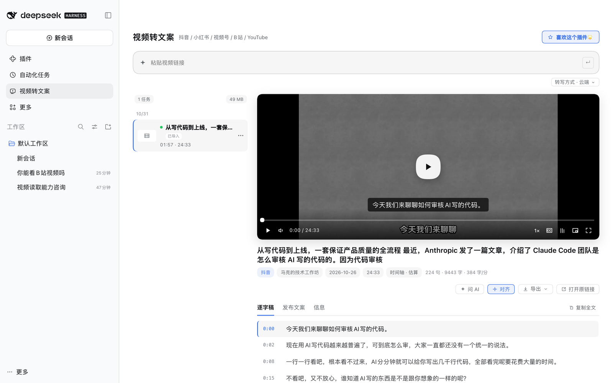

<h1 align="center"> dsh-video2text</h1>

<p align="center">Paste a video link, get the publishing copy and a full spoken transcript. The plugin ships its own skill; the UI is one sidebar workbench.</p>

<p align="center">
  <a href="https://github.com/vlln/dsh-video2text/releases/latest"></a>
  <a href="LICENSE"></a>
  
  <a href="https://github.com/vlln/dsh-video2text/discussions"></a>
  <b>English</b> · <a href="README.md">中文</a>
</p>

https://github.com/user-attachments/assets/b2129376-e838-494e-9b89-7041f4acf57c

<p align="center">17s · paste a WeChat Channels link → queued → transcribed</p>



Chinese-first, works for Douyin, Xiaohongshu, WeChat Channels, Bilibili and YouTube. Transcription runs in the cloud by default (faster, better Chinese punctuation) and can be switched entirely to local. The media is written to disk before transcription finishes, so you can watch while it runs.

> 中文说明见 [README.md](README.md)。

## Why

Getting copy out of a video usually means: open the page → copy the description → transcribe by hand → reformat. Do that ten times and you have ten rounds of busywork, plus a timeline you forgot to build.

This plugin moves the whole loop into the dsh sidebar: paste, press Enter, and parsing / download / transcription / alignment / layout all happen locally. Everything lands in one directory you can open, export, or hand to an agent.

## Install

```sh
dsh plugin --profile web add dsh-video2text
# to track the latest commit instead: dsh plugin --profile web add "github:vlln/dsh-video2text"
```

Restart `dsh web` afterwards (the Node half registers at boot). A "Video to Text" entry then appears in the sidebar.

Requirements: macOS, Python 3.9+, `ffmpeg`, `node`; `playwright` + Chrome for WeChat Channels; `mlx-whisper` (Apple Silicon) or `whisper.cpp` for local transcription.

### Skill only, without the plugin

`skills/video2text/` in this repo is the complete video2text skill (engine scripts + `SKILL.md`), usable on its own:

```sh
git clone --depth 1 --filter=blob:none --sparse https://github.com/vlln/dsh-video2text
cd dsh-video2text
git sparse-checkout set skills/video2text      # fetch just that subfolder
```

To install it into another agent (e.g. `~/.claude/skills/video2text`), `SKILL.md` and `scripts/` must sit side by side — the `scripts` entry under `skills/video2text/skills/video2text/` is a relative symlink and breaks when copied alone:

```sh
mkdir -p ~/.claude/skills/video2text
cp skills/video2text/skills/video2text/SKILL.md ~/.claude/skills/video2text/
cp -R skills/video2text/scripts ~/.claude/skills/video2text/
```

Self-check after installing: `python3 ~/.claude/skills/video2text/scripts/video2text --status` (for Douyin, run `--setup-douyin` first).

## What you get

| Capability | Notes |
|---|---|
| Platforms | Douyin / Xiaohongshu / WeChat Channels / Bilibili / YouTube / local files |
| Cloud ASR | Qwen3-Omni via Bailian — noticeably better on names and punctuation |
| Local ASR | mlx-whisper / whisper.cpp, offline and free |
| Sentence alignment | One-shot action; refines boundaries with local word timestamps |
| Player | Custom controls, synced transcript, subtitles, PiP, fullscreen |
| Export | Publish draft / SRT / ZIP |
| Accounts | Douyin & Xiaohongshu QR sign-in; WeChat Channels sign-in + session check |
| Jobs | Search, day groups, retry-in-place, delete, import from other folders |
| Agent handoff | "Ask AI" opens a session in the task workspace with context pre-filled |

## For agents (`video_text` / `video_frames`)

The package also ships a panel-independent plugin row, `dsh-video2text/inspect`, exposing two tools:

| Tool | Input | Output |
|---|---|---|
| `video_text` | media path or `vid_xxxxxxxx`, optional `from`/`to` | timestamped transcript lines; starts a background job if not transcribed yet |
| `video_frames` | same, plus `mode` (shots/uniform), `size` (overview/detail), `at` | one contact sheet with per-cell timestamps, or one high-resolution frame |

Behaviour:

- **No job ids to learn**: pass a media path once; the tool returns `vid_<8hex>` derived from the file fingerprint, and every later call can use it.
- **25 s soft deadline**: transcription or long-video sampling beyond that becomes a background job (`v2t-video-<id>`) with an in-session completion notice; the call returns `status: running` immediately and the same vid fetches the result later.
- **One job per asset**: repeated or concurrent requests reuse the running job instead of re-transcribing.
- `mode: shots` keeps only frames whose picture actually changed (slides, screens, subtitle switches) using dHash, not ffmpeg's `scene` filter.
- Cache lives in `$DSH_HOME/data/dsh-video-inspect/<vid>/`, separate from the panel's `out/`.
- Disabling the panel row keeps both tools working.
- To hide only the sidebar entry, turn off the `showEntry` option of `dsh-video2text` on the DSH **Plugins** page and reload; the agent tools are unaffected.
- Accounts and other settings live in **Settings → Video to text**; the plugin page keeps only the `showEntry` switch.

## Where data lives

| Item | Path |
|---|---|
| Jobs and artifacts | `$DSH_HOME/data/dsh-video2text/out/<job-id>/` |
| Job index | `$DSH_HOME/data/dsh-video2text/jobs.json` |
| Model cache | `~/.cache/video2text/hf` (shared across instances) |
| Engine config (with keys) | `~/.config/video2text/config.json` (mode 600) |
| Browser profiles | `~/.cache/video2text/chrome-profile` etc. |

Keys stay in the local config file and are hidden in the UI by default. Cloud transcription uploads audio chunks to the configured ASR endpoint; local mode never leaves the machine. No telemetry. Media is pruned after 14 days / 5 GB (only media — copy and subtitles are kept).

## Skills

The plugin bundles `skills/video2text` (SKILL.md + scripts + docs + examples) and symlinks it into `$DSH_HOME/skills/video2text`, so the agent discovers it through the normal skill path — no extra tool is registered.

Want the skill without the plugin? Take it straight from this repo:

```sh
git clone --depth 1 https://github.com/vlln/dsh-video2text
cd dsh-video2text/skills/video2text
cp -R skills/video2text ~/.agents/skills/video2text   # or your own skills dir
python3 scripts/video2text "https://www.bilibili.com/video/BV…" --out ./out
```

## Compatibility

| dsh version | Status |
|---|---|
| `0.2.1-rc.1` | ✅ verified (2026-10-20) |
| others | ⚠️ unverified — check the boot log for `plugin tree failed to load` if the panel is missing |

## Known limits

- WeChat Channels depends on a Tencent Yuanbao session; when it expires the task asks you to sign in again.
- Douyin needs DouK-Downloader plus a local cookie; Xiaohongshu uses a local XHS-Downloader service (falls back to yt-dlp, with less coverage).
- Install DouK once with `video2text --setup-douyin` (idempotent; defaults to `~/.local/share/video2text/DouK`). Do not keep it under `/tmp` — the system cleans it and jobs then fail with `[service:douyin]`.
- YouTube returns a bot check without a signed-in session: set a browser cookie, or run bgutil (`docker run -d -p 4416:4416 brainicism/bgutil-ytdlp-pot-provider`) plus its yt-dlp plugin and put the URL into "YouTube PO token". A PO token does **not** bypass IP-level blocks — datacenter egress still needs cookies. Details: [docs/youtube.md](docs/youtube.md).
- Long cloud transcriptions are dominated by server-side queueing (a 16-minute video took ~4 minutes); chunk size barely matters.
- One session per platform; no multi-account support yet.

## Plugin management

Install / remove / toggle with the official CLI: `dsh plugin --profile web add|remove <pkg>`. Installed plugins are listed and configured on the sidebar **Plugins** page.

## License

MIT. Upstream tools are invoked over HTTP/CLI, never linked: yt-dlp (Unlicense), DouK-Downloader and XHS-Downloader (GPL-3.0), bgutil-ytdlp-pot-provider (MIT).
