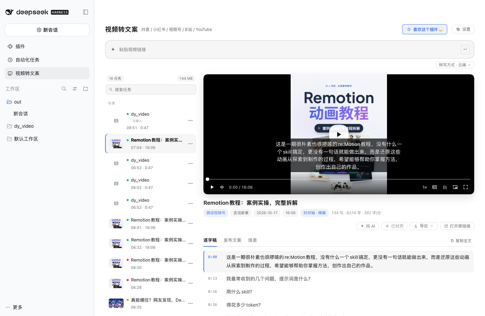
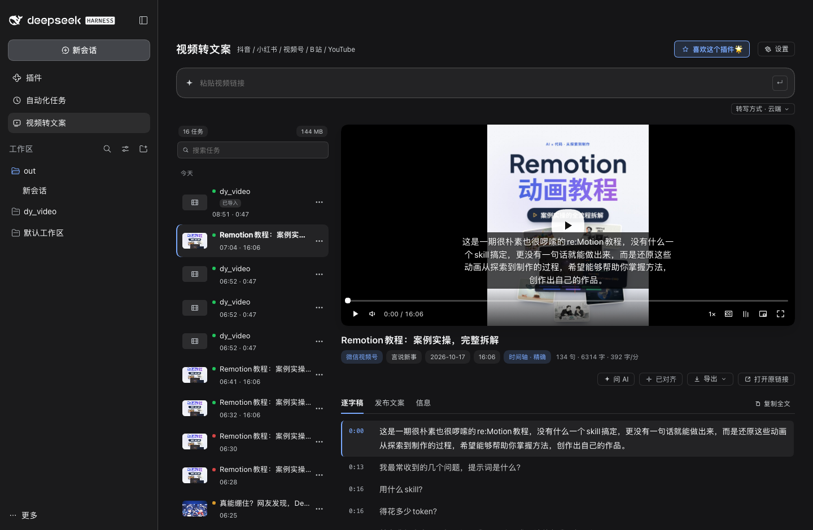
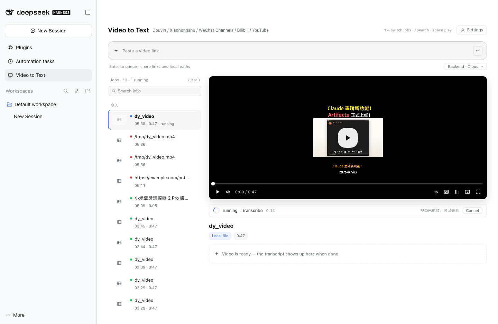
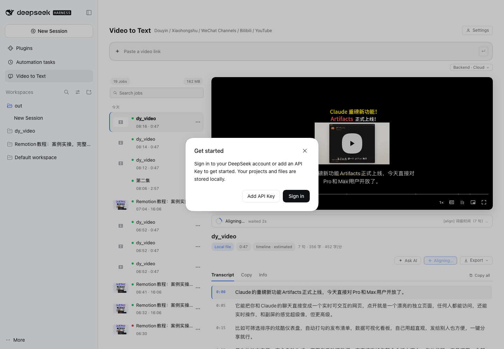
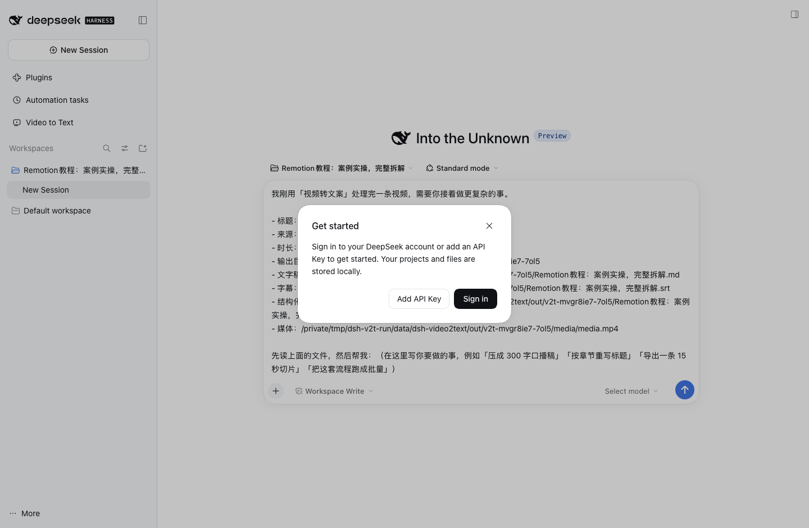
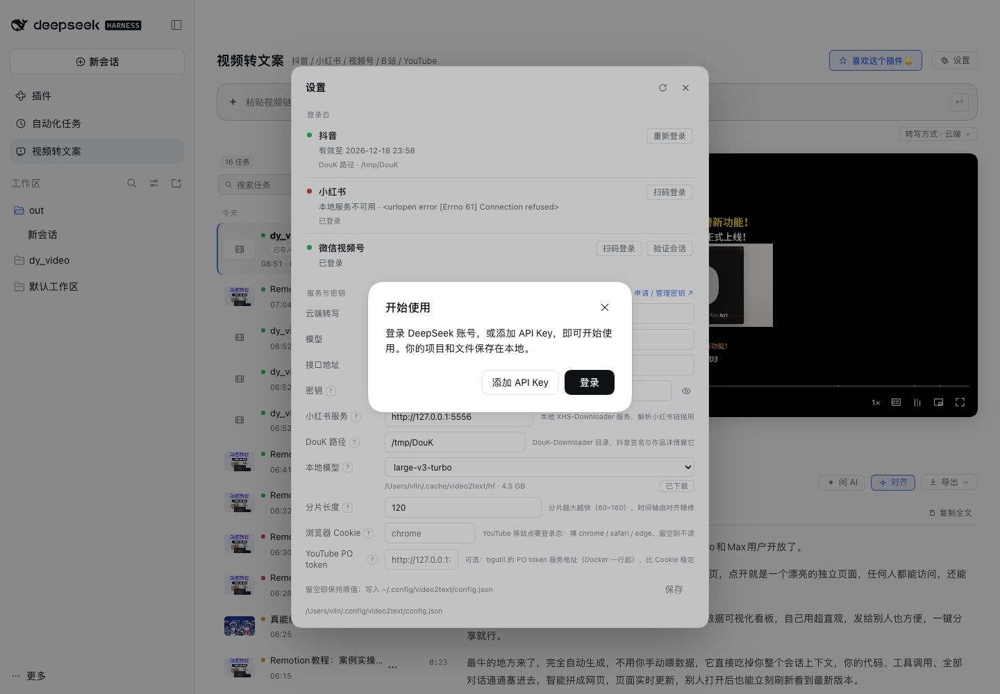
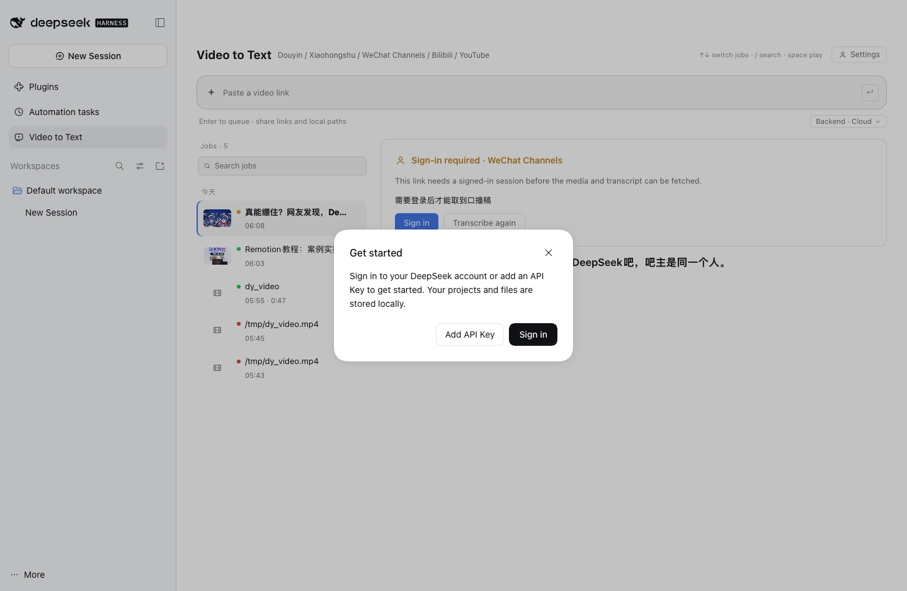

<h1 align="center">dsh-video2text</h1>

<p align="center">粘贴视频链接，得到「发布文案 + 口播逐字稿」。插件自带 skill，界面上是一个侧栏工作台。</p>



抖音、小红书、微信视频号、B站、YouTube 的分享链接 → 发布文案、逐字稿、字幕、章节稿。转写默认走云端（更快更准），也可以整条切成本地；媒体先落盘，转写没跑完就能先看片子。

## 为什么需要它

取一条视频的文案，通常要：打开网页 → 复制简介 → 手动听写或跑一遍转写 → 自己排版。批量做十条，就是十次重复劳动，还容易漏掉时间轴。

这个插件把这件事收进 dsh 侧栏：贴链接、按回车，剩下的解析、下载、转写、对齐、排版都在本机跑，产物落在一个目录里，可以直接打开、导出，或者交给 agent 继续加工。

和「自己跑一遍脚本」的区别：**任务列表、播放器、逐字稿同步、导出、登录态**都在界面上，不用记命令。和「纯 CLI 工具」的区别：脚本本身仍是独立可用的 skill，不依赖 dsh。

深色主题跟随系统：



## 安装

**从 GUI**：侧边栏 **Plugins** → 添加插件 → 填入 `github:vlln/dsh-video2text`。

**从 CLI**：

```sh
dsh plugin --profile web add "github:vlln/dsh-video2text"
```

装完**重启 `dsh web`**（Node half 的注册在启动时完成），之后侧栏出现「视频转文案」。

运行环境：

- macOS（视频号解密与本地转写依赖 macOS 工具链；其他平台未验证）
- Python 3.9+、`ffmpeg`、`node`
- 视频号需要 `playwright` + 本机 Chrome（`pip install playwright`）
- 本地转写用 `mlx-whisper`（Apple Silicon）或 `whisper.cpp`

## 用起来

### 入列即转写

粘贴链接按回车（或点「开始」）就直接建任务，没有「预览 → 确认 → 开始」的往返。任务名就是抓到的视频标题，封面、作者、时长随元数据回来补上，写进任务记录（刷新、搜索都在）。本地文件用文件名兜底。

### 边转边看

媒体下载完立刻落盘，播放器马上可用，转写在旁边继续跑，逐字稿完成后原地出现。多个任务并行，互不阻塞。



### 播放器 + 逐字稿

自绘控件（播放/暂停、拖拽、倍速、字幕、跟随高亮、画中画、全屏），逐字稿按句同步高亮；点一句跳到对应时间。键盘：`空格` 播放/暂停、`←→` 快退快进、`↑↓` 切任务、`/` 搜索。

字幕时间轴有「估算」和「精确」两种状态，标题下的胶囊会标出来。

### 对齐（一次性动作）

默认**不做**词级对齐：云端转写后按标点切句、在分片内按字数插值时间 —— 对连续口播通常只差零点几秒，而且**不需要本地模型**。

需要更准的边界时，点「对齐」：用本地 whisper 的词级时间重算每句起止，只更新 json/srt，不重转、不改文案。对齐中会显示进度条与实时日志，完成后胶囊变成「时间轴 · 精确」。



### 导出

三个出口，够用且不重复：

| 选项 | 产物 |
|---|---|
| 发布稿（带章节） | 标题 / 发布文案 / 自动章节 / 正文 / 字数语速 |
| 字幕 SRT | 逐句字幕 |
| 全部（ZIP） | 上面两份 + sidecar JSON |

### 问 AI

选中一条任务点「问 AI」：新建一个会话，自动切到任务目录所在的工作区，并把上下文（标题、来源、时长、输出目录、文字稿/字幕/sidecar/媒体的绝对路径）填进输入框。回车就把活交给 agent —— 压稿、重写标题、切片段、跑批量。



工作区是「所有任务的上一级目录」，agent 能一并管理其它任务的产物。插件只读选择、不创建：侧栏里没有这个工作区时，会提示你用 `Add workspace…` 指一次。

### 设置

右上角「设置」，两段：

- **登录态**：抖音 / 小红书 / 视频号 的状态与扫码入口，「验证会话」会给绿/红反馈
- **服务与密钥**：云端转写的 provider / model / base URL / 密钥（默认隐藏，眼睛可看）、小红书服务地址、DouK 路径、本地模型、分片长度、浏览器 Cookie、YouTube PO token

每个字段旁有 `?`，悬停即显用途说明。



### 任务列表

按今天/昨天分组、可搜索；每条右侧 `⋯` 里有「复制链接」「删除任务（含文件）」。缺登录时任务会进入「需要登录」状态，卡片上直接扫码，扫完自动重跑。



### agent 直接跑脚本的结果也会出现

面板会扫描以下目录，把含 sidecar JSON 的子目录收编成任务（标 `imported`）：

1. `$DSH_HOME/data/dsh-video2text/out`
2. 环境变量 `VIDEO2TEXT_IMPORT_DIRS`（`:` 分隔）
3. 插件配置 `importDirs`（逗号分隔）

导入的任务是**只读收编**：删除只从列表移除、不删磁盘，媒体保留策略也不会碰它们。

## 能力面

| 能力 | 说明 |
|---|---|
| 平台 | 抖音 / 小红书 / 微信视频号 / B站 / YouTube / 本地文件 |
| 云端转写 | Qwen3-Omni（百炼），中文标点与专名明显更好 |
| 本地转写 | mlx-whisper / whisper.cpp，离线免费 |
| 句级对齐 | 可选的本地词级对齐，一次性动作 |
| 播放器 | 自绘控件、逐字稿同步、字幕、画中画、全屏 |
| 发布导出 | 发布稿 / SRT / ZIP |
| 登录态 | 抖音、小红书扫码；视频号扫码 + 会话验证 |
| 任务管理 | 搜索、分组、重试复用原卡、删除、跨目录导入 |
| 会话 | 「问 AI」把任务上下文交给 agent，并切到任务工作区 |

## 数据与权限

| 内容 | 位置 |
|---|---|
| 任务与产物 | `$DSH_HOME/data/dsh-video2text/out/<任务ID>/` |
| 任务索引 | `$DSH_HOME/data/dsh-video2text/jobs.json` |
| 模型缓存 | `~/.cache/video2text/hf`（跨实例共享） |
| 引擎配置（含密钥） | `~/.config/video2text/config.json`（600） |
| 扫码会话 | `~/.cache/video2text/chrome-profile` 等 Chrome profile |

- 密钥只在本机配置文件里，界面上默认隐藏。
- 转写若选「云端」，音频分片会上传到配置的 ASR 服务；选「本地」则不出本机。
- 插件不向任何第三方上报使用数据。
- 媒体默认按 14 天 / 5 GB 清理（只删媒体，文案与字幕保留）。

## 与 skill 的关系

插件自带 `skills/video2text`，首次加载时软链到 `$DSH_HOME/skills/video2text`，agent 通过常规 skill 发现路径读到它 —— 不给 agent 新增工具。skill 本身可脱离 dsh 单独使用（`python3 scripts/video2text <url> --out ./out`）。

## 兼容性

| dsh 版本 | 状态 |
|---|---|
| `0.2.1-rc.1` | ✅ 已验证（2026-10-20） |
| 其它版本 | ⚠️ 未验证 —— 升级后若面板不出现，先看 boot 日志里的 `plugin tree failed to load` |

## 已知限制

- 视频号依赖腾讯元宝的登录态；失效后会退回「需要登录」，重扫即可。
- 抖音依赖 DouK-Downloader 与本机登录 Cookie；小红书依赖本地 XHS-Downloader 服务（没起会回退 yt-dlp，能拿到的内容变少）。
- YouTube 从 2025 起对无登录态请求返回 bot 校验。两条路（见下节）：**浏览器 Cookie** 最省事；**bgutil PO token** 更稳，但要装 yt-dlp 插件。
- 长视频的云端转写受服务端排队影响（16 分钟视频实测 4 分钟上下），分片大小不是瓶颈。
- 未做「多账号并存」：一个平台一份登录态。

## YouTube 的 bot 校验怎么解

YouTube 从 2025 起对无登录态请求返回 `Sign in to confirm you're not a bot`。社区（[PO Token Guide](https://github.com/yt-dlp/yt-dlp/wiki/PO-Token-Guide) 与 [bgutil-ytdlp-pot-provider](https://github.com/Brainicism/bgutil-ytdlp-pot-provider)）的解法是 **PO token**，由「provider 造 token」+「yt-dlp 插件交 token」两部分组成。

### 装法（本机实测通过）

```sh
# 1) provider（Docker，端口 4416，只绑回环）
docker run --name bgutil-provider -d --init \
  -p 127.0.0.1:4416:4416 brainicism/bgutil-ytdlp-pot-provider

# 2) yt-dlp 插件（放用户插件目录；对本机 uvx 装的 yt-dlp 生效）
mkdir -p ~/.config/yt-dlp/plugins
curl -sL -o /tmp/pot.zip \
  https://github.com/Brainicism/bgutil-ytdlp-pot-provider/releases/latest/download/bgutil-ytdlp-pot-provider.zip
unzip -oq /tmp/pot.zip -d ~/.config/yt-dlp/plugins/bgutil-ytdlp-pot-provider
```

> 注意：`~/Library/Application Support/yt-dlp/plugins` 在 `uvx` 装的 yt-dlp 上**不会被发现**（实测 `Plugin directories: none`），要放 `~/.config/yt-dlp/plugins`。插件放别处时，用配置项 `yt_plugin_dirs` 指定目录（引擎会传 `--plugin-dirs`）。

把 provider 地址填进「设置 → YouTube PO token」（默认就是 `http://127.0.0.1:4416`），引擎会传：

```
--extractor-args "youtubepot-bgutilhttp:base_url=http://127.0.0.1:4416"
```

### 怎么确认插件真的在工作

```sh
yt-dlp -v --simulate --extractor-args "youtubepot-bgutilhttp:base_url=http://127.0.0.1:4416" <url>
```

输出要有这两行（第一行说明插件加载了，第二行说明 token 真的被请求了）：

```
[youtube] [pot] PO Token Providers: bgutil:http-2.0.2 (external), …
[youtube] [pot:bgutil:http] Generating a gvs PO Token for web client via bgutil HTTP server
```

### 它救不了什么

provider 的 README 写得很明确：**PO token 不绕过 IP 级的登录限制**。如果只有第一行、没有第二行（token 流程根本没触发），说明请求在更早的 `LOGIN_REQUIRED` 就被拒了，通常是出口 IP 被判定为机房。

本机（机房出口）实测：插件 + provider 都装好、provider `/ping` 返回 200、`PO Token Providers: bgutil:http-2.0.2` 正常列出，但**七种 player_client 全部在 token 之前被拦**；同时这台机器没有 Chrome 配置（`--cookies-from-browser chrome` 报找不到 cookie 库），所以 Cookie 这条路也不可用。

结论按网络环境选：

| 网络 | 该用什么 |
|---|---|
| 家宽 / 普通出口 | PO token（上面两步），多半就通了 |
| 机房 IP / 代理出口 | 必须 Cookie；token 只能缓解，不能绕过 |
| 临时看一条 | `--cookies-from-browser chrome` 最快 |

## 装好之后怎么确认

1. 侧栏出现「视频转文案」，点进去能看到输入框与任务列表。
2. 贴一个 B 站链接回车：几秒内出现任务卡与封面，随后能看到播放器。
3. 转写完成点「导出 → 发布稿」，应下载一个 `.publish.md`。

卸载：`dsh plugin --profile web remove dsh-video2text`，再重启 `dsh web`。

## 插件管理

装/卸/启停用官方 CLI：`dsh plugin --profile web add|remove <包>`；已装插件在**侧边栏 Plugins 页**里查看与配置。

## 开发

把仓库放进 profile 的 `local/`，在 profile 的 `package.json` 里加一行 `"dsh-video2text": "link:.../local/dsh-video2text"`，并把它加进 `dsh.profile.bundles`；改完重启 `dsh web`（client 改动刷新即可）。

## 许可

MIT。运行时通过 HTTP/CLI 调用上游工具，不链接其代码：yt-dlp（Unlicense）、DouK-Downloader 与 XHS-Downloader（GPL-3.0）、bgutil-ytdlp-pot-provider（MIT）。
